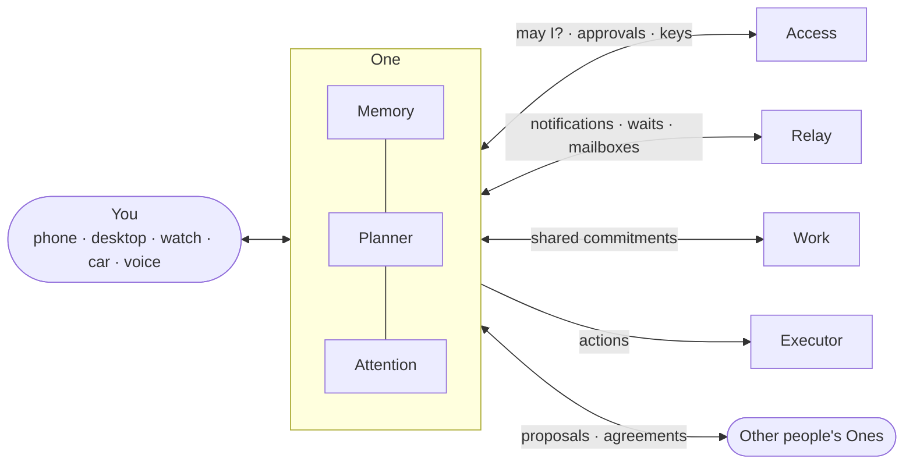

# One

**The personal agent that works for you.**

One is a user-owned, model-independent personal agent. It remembers what matters to you, acts on your behalf within limits you set, and interrupts you only when it is worth it. It lives across your phone, desktop, watch and car, and it is the same One everywhere.

> Internal repository. One is proprietary software operated by Suiss.

---

## What One does

**Remembers you, on your terms**
- Structured memory with confidence and provenance: "you said", "I think", "not sure"
- See, correct, stop using or permanently forget anything
- Life areas (work, health, finance, home …) kept apart; full structured export at any time

**Acts within limits you set**
- "Do it yourself / ask me first / leave it to me" per kind of action, enforced by Suiss Access
- A fixed list of things One can never do on its own: passwords, new payment methods, first transfers to new recipients, deleting your account
- Rules like "if the flight drops below 40k, book it, up to 40k, until Friday"

**Protects your attention**
- Interrupts only when the value is worth the cost; otherwise waits for a natural break or adds it to a short daily summary that ends
- Never optimizes for opens, time spent or daily active use

**Works with people and their Ones**
- Proposes, counters and agrees with other people's Ones; agreements become Suiss Work commitments
- End-to-end encrypted, minimal disclosure, no unsolicited contact from strangers

**Private by design**
- Your keys stay on your devices; cloud processing runs in attested confidential computing
- No inference about health, religion, politics or sexual life unless you turn it on
- Your data trains only your own models

## How it works



## Stack

Rust (cloud services and a shared client core), PostgreSQL with pgvector, encrypted object storage, Suiss-operated open models (Qwen3.5 4B and 27B, EmbeddingGemma 2) with per-user adapters, native iOS/Android/desktop surfaces and a shared TypeScript workspace. Languages: Turkish and English.

## Development

```sh
just dev    # PostgreSQL, object storage, local Access, Relay and Work, model server
just test
```

See [CONTRIBUTING.md](CONTRIBUTING.md).
